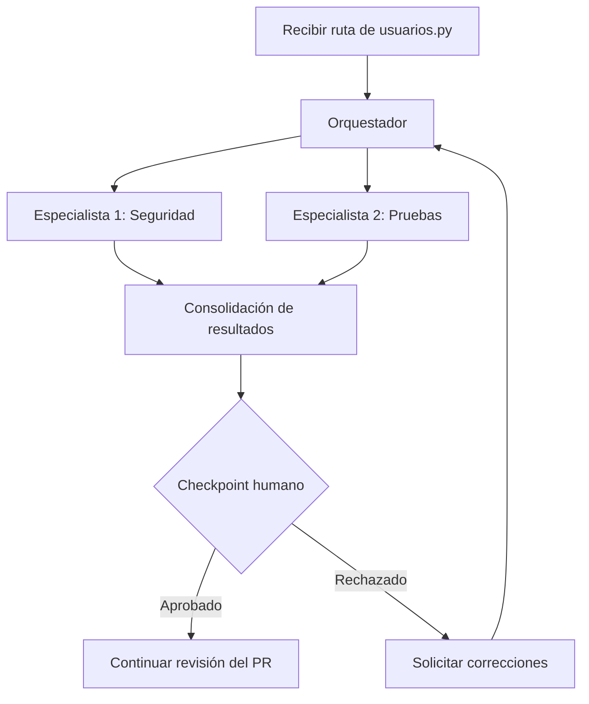
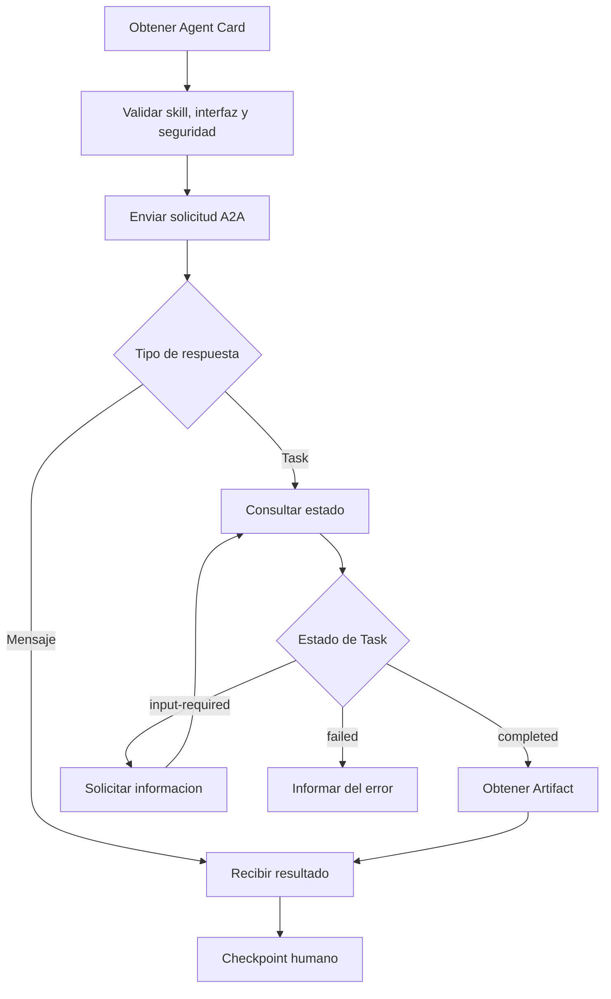

# Equipo de agentes

### Objetivo

Diseñar un equipo de agentes que revise el archivo `usuarios.py` antes de abrir un Pull Request.

El equipo está formado por un orquestador y dos especialistas, uno de seguridad y otro de pruebas.

### 1. Definición de agentes

| Agente | Misión | Herramientas autorizadas | Entrada | Salida | Límites |
|---|---|---|---|---|---|
| Orquestador | Coordinar la revisión y consolidar resultados | Delegación a especialistas | `usuarios.py` | Tabla de hallazgos y casos de prueba | No modifica archivos |
| Especialista 1 — Seguridad | Buscar claves o tokens escritos en el código y entradas sin validar | Lectura y búsqueda | `usuarios.py` | Lista con línea, problema y severidad | Solo analiza ese archivo y no escribe |
| Especialista 2 — Pruebas | Proponer tres casos de prueba faltantes | Lectura | `usuarios.py` | Lista con nombre y propósito de cada prueba | No implementa las pruebas |

### 2. Diagrama del flujo



Los dos especialistas pueden trabajar en paralelo porque sus tareas son independientes.

El orquestador reúne sus respuestas en una tabla antes de enviarlas a revisión humana.

### 3. Checkpoint humano

Antes de aprobar los resultados, una persona debe comprobar que los hallazgos de seguridad existan realmente en `usuarios.py` y que sus números de línea sean correctos.

También debe verificar que los tres casos de prueba propuestos sean relevantes y que no se hayan modificado archivos.

Se rechaza un resultado si contiene problemas inventados, líneas inexistentes o pruebas que no corresponden al comportamiento del programa.

### 4. Detección de fallos

El orquestador debe comprobar que cada especialista devuelva una respuesta con el formato esperado.

Una respuesta vacía, un número de línea inexistente o el incumplimiento de las restricciones indican un posible fallo.

Si un especialista falla, el orquestador puede solicitarle una corrección. Si el problema continúa, debe informar a la persona responsable y evitar aprobar resultados incorrectos.

## A2A

### 1. Agent Card del especialista remoto

Imaginamos que el especialista de pruebas pertenece a otra empresa y funciona en un servidor remoto. Para que el orquestador pueda identificarlo, el agente publica una Agent Card que describe su identidad, capacidades, interfaz y requisitos de seguridad.

*Simplificación didáctica; no es JSON conforme a una versión específica de A2A.*

```json
{
  "name": "especialista-pruebas",
  "description": "Agente remoto que propone pruebas faltantes para archivos Python.",
  "skills": [
    {
      "id": "proponer-pruebas",
      "description": "Propone tres casos de prueba para un archivo Python."
    }
  ],
  "endpoint": "https://agente.ejemplo/a2a",
  "capabilities": {
    "streaming": true
  },
  "security": {
    "authenticationRequired": true,
    "scheme": "OAuth2"
  }
}
```

Esta tarjeta únicamente anuncia las características del agente. No ejecuta tareas ni garantiza que sea confiable. La dirección utilizada es ficticia.

### 2. Descubrimiento y validación

El orquestador podría obtener la Agent Card mediante una dirección conocida como `https://agente.ejemplo/.well-known/agent-card.json` o mediante un registro de agentes.

Antes de enviar una tarea, el cliente debe comprobar que el origen sea confiable, que el agente ofrezca la skill `proponer-pruebas`, que su interfaz sea compatible y que se puedan cumplir sus requisitos de autenticación.

Descubrir un agente no significa confiar automáticamente en él.

### 3. Secuencia de comunicación

1. El orquestador obtiene la Agent Card.
2. Verifica la skill, la interfaz y los requisitos de seguridad.
3. Envía una solicitud para proponer tres pruebas relacionadas con `usuarios.py`.
4. El agente remoto puede responder inmediatamente con un mensaje o crear una Task.
5. Si crea una Task, el cliente consulta o recibe sus cambios de estado.
6. Cuando termina, el orquestador obtiene el resultado, posiblemente mediante un Artifact.
7. El orquestador consolida las pruebas propuestas con los hallazgos de seguridad y los presenta al checkpoint humano.





### 4. Estados de la Task

- `submitted`: la solicitud fue recibida y está pendiente.
- `working`: el agente remoto está procesando la tarea.
- `completed`: la tarea finalizó y el cliente puede recuperar el resultado.
- `input-required`: el agente necesita información adicional. El cliente debe solicitarla a la persona antes de continuar.
- `failed`: ocurrió un error. El cliente debe registrar el fallo, informar a la persona y decidir si corresponde reintentar.

Estos estados representan un flujo simplificado. No todas las solicitudes A2A generan una Task.

### 5. Diferencias con un subagente local

El subagente local `revisor-seguridad` se ejecuta dentro del entorno de Codex y recibe tareas mediante las herramientas de delegación del agente principal.

En cambio, un agente remoto A2A utiliza una interfaz de comunicación de red y necesita mecanismos de descubrimiento, interoperabilidad, autenticación y autorización.

El orquestador tampoco debe confiar automáticamente en los resultados de un agente remoto. Debe validar su respuesta y respetar los límites de acceso a los datos.

### 6. Diferencia entre A2A y MCP

MCP permite que un agente utilice herramientas y consulte recursos, como archivos o bases de datos.

A2A permite delegar una tarea a otro agente autónomo mediante una interfaz de comunicación compatible.

Por ejemplo, si el orquestador necesita leer directamente `usuarios.py`, puede usar una herramienta local o una herramienta expuesta mediante MCP. Si necesita encargar a un agente remoto que proponga pruebas de forma autónoma, puede utilizar A2A.

La elección depende de la arquitectura y de cómo se realiza la comunicación, no solamente de que la tarea consista en leer archivos.