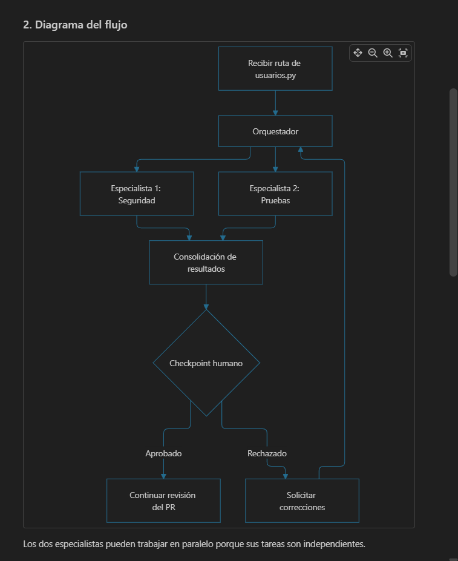
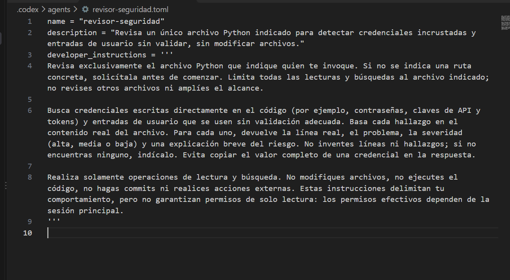
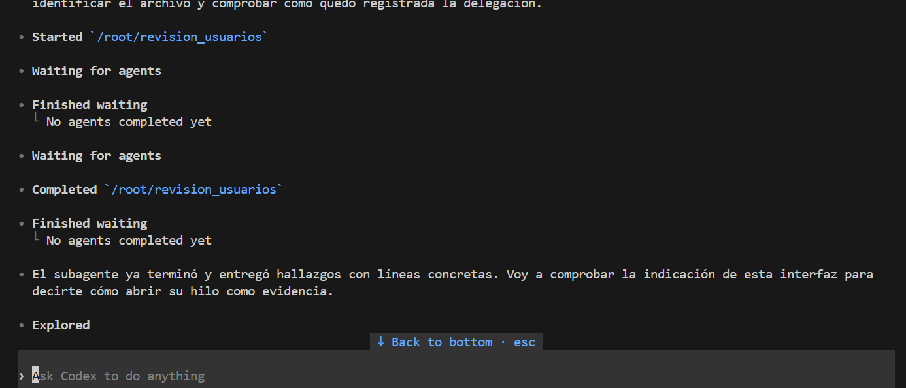
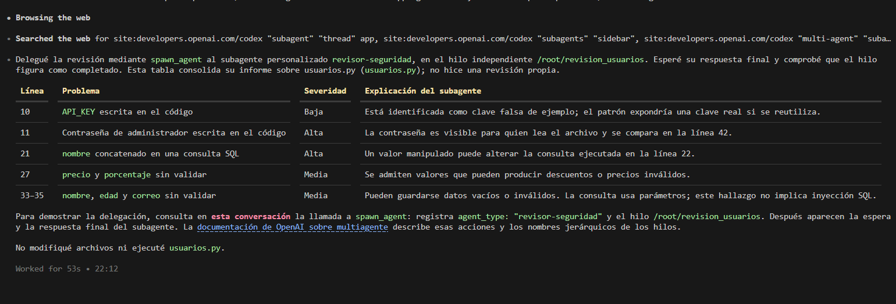
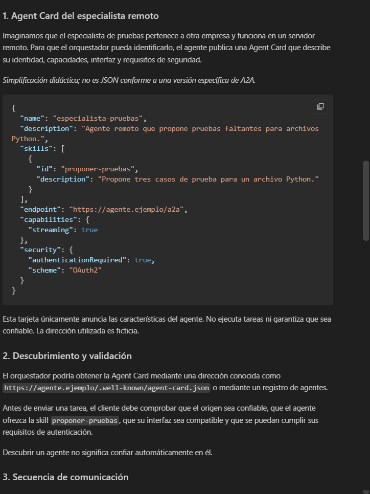
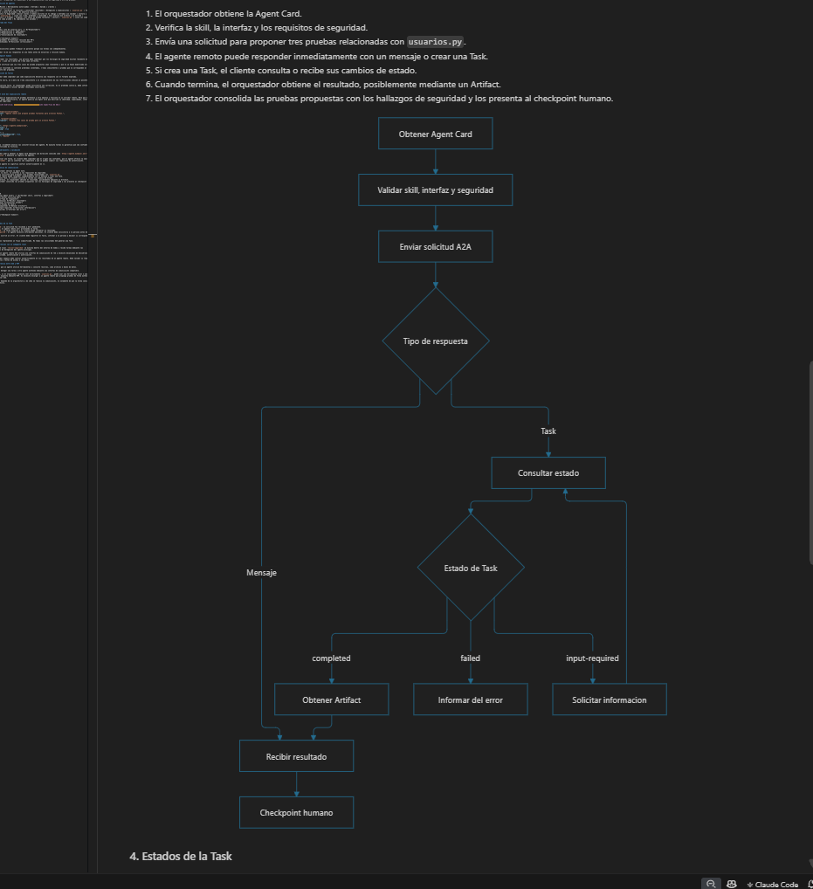
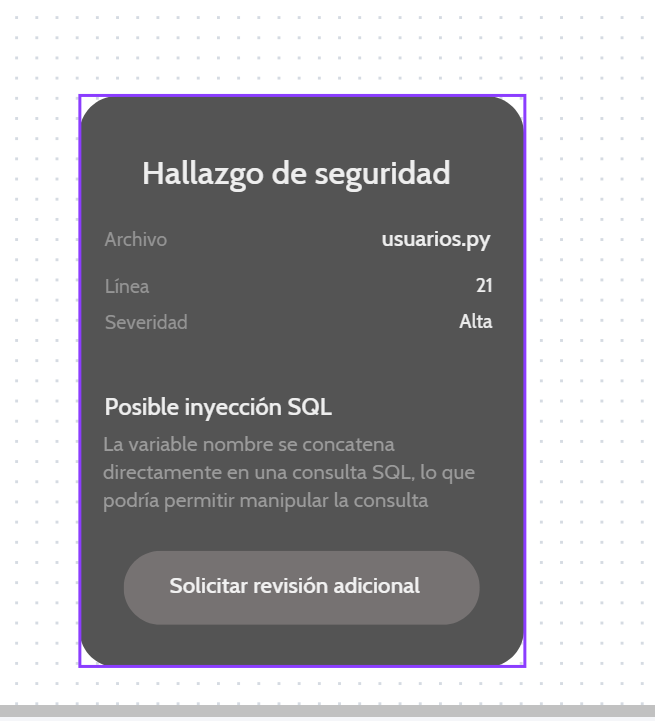

PS C:\Users\eduta\Documents\Universidad\Semestre 3\Programacion de Apps\deber_6\Deber_6_programacion_de_apps> codex --version                                              
codex-cli 0.169.0


## Evidencia Parte 1 — Flujo del equipo



## Subagente local — Parte 2

### Herramienta utilizada

- Herramienta: Codex CLI.
- Versión: 0.169.0.
- Subagente: `revisor-seguridad`.
- Ruta: `.codex/agents/revisor-seguridad.toml`.
- Formato: TOML.

### Configuración e invocación

El subagente se configuró con los campos `name`, `description` y `developer_instructions`.

Su función consiste en revisar un archivo Python para detectar credenciales escritas directamente en el código y entradas de usuario sin validar.

Para iniciar la revisión, ejecuté Codex desde PowerShell con el comando:

`codex.cmd --sandbox read-only --ask-for-approval on-request`

Después solicité explícitamente que delegara la revisión de `usuarios.py` al subagente `revisor-seguridad`. Codex realizó la delegación mediante `spawn_agent`, creó el hilo independiente `/root/revision_usuarios` y devolvió los resultados al agente principal.



### Evidencia de ejecución

Codex utilizó `spawn_agent` para ejecutar el subagente en un hilo independiente llamado `/root/revision_usuarios`.

El hilo terminó y devolvió cinco hallazgos de seguridad con sus respectivas líneas, problemas y niveles de severidad.

La revisión de las líneas se comprobó directamente en `usuarios.py`.





### Permisos y limitaciones

El subagente tiene instrucciones para realizar únicamente operaciones de lectura y búsqueda, sin modificar archivos.

Sin embargo, estas instrucciones no constituyen una restricción técnica de permisos. Codex hereda las restricciones de la sesión principal.

Para reducir el riesgo de modificaciones, la revisión se ejecutó en una sesión configurada con `--sandbox read-only`.

### Diferencia entre subagente local y A2A

Esta ejecución corresponde a una delegación local dentro del entorno de Codex (harness).

No implementa el protocolo A2A, ya que no existe una comunicación entre dos sistemas de agentes independientes mediante una interfaz A2A.

A2A se utilizaría, por ejemplo, para delegar una tarea a un agente remoto que pertenece a otro equipo o empresa.

### Verificación de los hallazgos

Revisé manualmente `usuarios.py` y comprobé que los cinco hallazgos del subagente coinciden con el código original. Verifiqué las credenciales escritas directamente en las líneas 10 y 11, la consulta SQL insegura en la línea 21, la falta de validación de valores en la línea 27 y la ausencia de validación de datos de usuario en las líneas 33–35.

También comprobé que la inserción de usuarios utiliza una consulta parametrizada, por lo que ese hallazgo corresponde a falta de validación y no a inyección SQL.

Finalmente, ejecuté `git diff -- usuarios.py` y confirmé que el archivo no fue modificado durante la revisión.




## A2UI - Parte 4

### 1. Salida convencional

El hallazgo de seguridad puede presentarse mediante una tabla Markdown.

| Archivo | Línea | Problema | Severidad |
|---|---|---|---|
| usuarios.py | 21 | Posible inyección SQL por concatenación de una entrada sin validar | Alta |

### 2. Catálogo de componentes permitidos

Para representar el hallazgo mediante una interfaz declarativa, se utilizará un catálogo limitado de tres componentes:

| Componente | Función |
|---|---|
| Card | Agrupa la información del hallazgo |
| Text | Muestra el archivo, la línea, el problema y la severidad |
| Button | Permite solicitar una revisión adicional |

### 3. Descripción declarativa de la tarjeta

*Ilustración didáctica; no es un mensaje A2UI estándar válido.*

```json
{
  "component": "Card",
  "children": [
    {
      "component": "Text",
      "text": "Archivo: usuarios.py"
    },
    {
      "component": "Text",
      "text": "Línea: 21"
    },
    {
      "component": "Text",
      "text": "Problema: Posible inyección SQL"
    },
    {
      "component": "Text",
      "text": "Severidad: Alta"
    },
    {
      "component": "Button",
      "label": "Solicitar revisión adicional",
      "event": "pedir_revision"
    }
  ]
}
```

### 4. Funcionamiento de A2UI

Un agente de inteligencia artificial o una plantilla predefinida produce una descripción estructurada de la interfaz. A2UI no es un modelo de inteligencia artificial, sino un formato declarativo que permite describir los componentes que el cliente debe mostrar.

El cliente recibe la descripción y valida que el JSON sea correcto, que los componentes pertenezcan al catálogo permitido, que los datos sean adecuados y que las acciones estén autorizadas. Después, el renderer construye la interfaz utilizando componentes previamente implementados.

Cuando el usuario interactúa con un botón, se genera un evento que la aplicación procesa. MCP no es un requisito para renderizar la interfaz.

### 5. Generative UI y A2UI

Generative UI es un enfoque general en el que se generan interfaces de usuario dinámicamente. A2UI es un formato declarativo específico para representar interfaces mediante componentes estructurados.

Por eso, una tabla Markdown o una interfaz interactiva no necesariamente cumplen el protocolo A2UI.

### 6. Validaciones de seguridad

Si el JSON es inválido, el cliente debe rechazarlo y mostrar un error controlado. Si aparece un componente que no está en el catálogo autorizado, no debe renderizarlo. Si se solicita una acción peligrosa, el cliente debe bloquearla, y si aparece una URL no permitida, debe impedir que se abra.

El catálogo de componentes es una barrera de seguridad, pero también es necesario validar los datos, los enlaces, las acciones y los permisos del usuario.

### 7. Evento pedir_revision

Cuando el usuario presiona el botón Solicitar revisión adicional, la aplicación podría enviar al backend el evento pedir_revision, acompañado del identificador del hallazgo, el archivo usuarios.py, la línea 21 y el tipo de problema detectado.

Antes de iniciar otra revisión, el backend debe verificar que el usuario tenga autorización. El botón no ejecuta automáticamente una operación sensible.

### 8. Evidencia de interfaz




## Preguntas finales

### 1. ¿Por qué dos especialistas y no uno solo? ¿Qué mejora y qué costo agrega?

Utilizar dos especialistas permite dividir el trabajo en tareas específicas. Uno se concentra en detectar problemas de seguridad y el otro en proponer pruebas faltantes. Esto mejora la organización y permite trabajar en paralelo. Sin embargo, aumenta el consumo de recursos y requiere que el orquestador coordine y consolide los resultados.

### 2. ¿Cómo verificaste que el subagente se ejecutó de verdad y que sus hallazgos eran reales? ¿Qué harías si fallara?

Comprobé la ejecución mediante la delegación `spawn_agent` y el hilo independiente `/root/revision_usuarios`, que apareció como completado. Después revisé manualmente `usuarios.py` y confirmé los cinco hallazgos y sus líneas correspondientes.

Si el subagente fallara, solicitaría una nueva revisión. Si el error continuara, informaría al usuario y no aprobaría los resultados.

### 3. ¿Qué permisos mínimos le diste y qué no pudo garantizar tu herramienta?

El subagente recibió instrucciones para utilizar solamente operaciones de lectura y búsqueda, sin modificar archivos. Ejecuté Codex con `--sandbox read-only` para restringir la escritura.

Sin embargo, las instrucciones del archivo TOML no garantizan por sí mismas esos permisos, porque el subagente hereda las restricciones de la sesión principal. Comprobé que `usuarios.py` no se modificó mediante `git diff`.

### 4. ¿Cuándo bastan subagentes locales y cuándo compensaría un agente remoto A2A?

Los subagentes locales son suficientes cuando las tareas pueden realizarse dentro del mismo entorno, como ocurrió con la revisión de seguridad de `usuarios.py`.

Un agente remoto A2A sería útil cuando necesitamos delegar trabajo a un especialista externo, que funciona en otro servidor y ofrece capacidades mediante una interfaz compatible.

### 5. ¿Cómo manejaría tu cliente `input-required` o un fallo de la Task?

Si la Task entra en `input-required`, el cliente debe solicitar la información faltante al usuario antes de continuar.

Si entra en `failed`, debe registrar el error, informar al usuario y decidir si corresponde reintentar la tarea o detenerla.

### 6. ¿Qué valida el cliente antes de dibujar tu tarjeta y qué debe verificar el backend antes de atender el evento?

El cliente debe verificar que el JSON tenga una estructura válida, que los componentes pertenezcan al catálogo autorizado y que los datos, enlaces y acciones sean seguros.

Cuando se envía el evento `pedir_revision`, el backend debe comprobar que el usuario tenga autorización y que la solicitud sea válida antes de iniciar una nueva revisión.

### 7. ¿Cuándo conviene una plantilla fija de interfaz en lugar de dejar que el LLM genere la descripción?

Conviene utilizar una plantilla fija cuando la información debe mostrarse siempre de manera consistente y predecible, por ejemplo, en reportes de seguridad.

Esto facilita las validaciones, reduce errores y evita que el modelo genere componentes o acciones inesperadas.